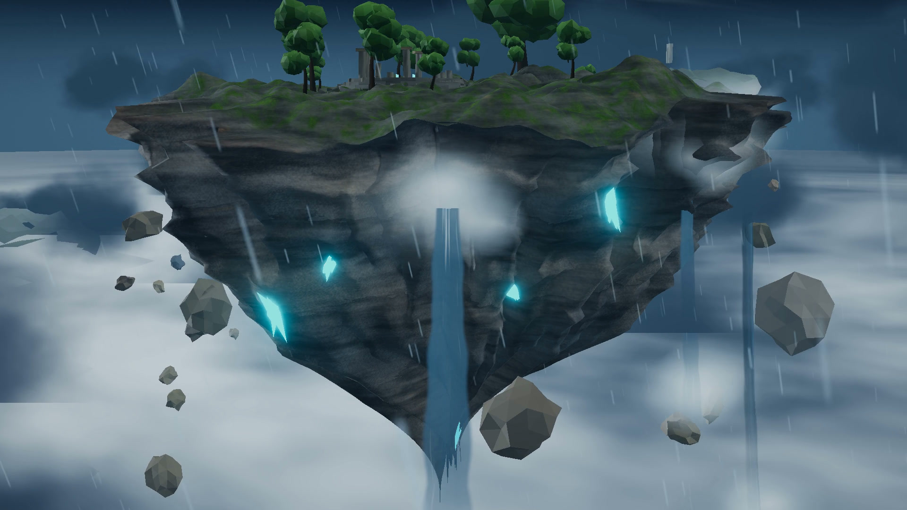

<div align="center">

# Claude Video

**A code-drawn film studio in one folder: one 40s sky-island film, every frame made from code.**<br>
One floating island, a storm sky, a whale, and a camera that knows where to look.<br>
<sub>一个用代码画出来的浮空岛 40 秒短片 · 🇨🇳 中文用户请看下方说明</sub>

<a href="claude-video/README.md"></a> <a href="https://github.com/haitaoworkspacebj/ff-claude-video"></a> <a href="#licence"></a>

⚠️ **Built for Claude.** The film is tuned for Claude Opus 5.5;<br>
other models may not reproduce it well, so use it with care.

<sub>Official repo: [github.com/haitaoworkspacebj/ff-claude-video](https://github.com/haitaoworkspacebj/ff-claude-video) · by [haitaoworkspacebj](https://github.com/haitaoworkspacebj)</sub>

</div>

## 🎬 Feature presentation: Skyward Realm

<table><tr>
<td width="50%" valign="top"><a href="claude-video/README.md"></a><br><b>▶ The film</b> · 40 s · 1920×1080<br><sub>A camera pushes through a storm-lit cloud sea, orbits a floating island with waterfalls and ruins, then pulls back to reveal a whale and distant islands.</sub></td>
<td width="50%" valign="top"><a href="claude-video/README.md"></a><br><b>Every frame from code</b> · Three.js · no stock footage<br><sub>Camera keyframes, a seeded lightning schedule, procedural terrain, water, clouds, rain and a whale — all written in TypeScript.</sub></td>
</tr></table>

<div align="center">

Every frame, every note and every cut was written in code by Claude Opus 5.5.<br>
[**▶ Watch the demo**](claude-video/README.md) · [**Source**](claude-video/) · [**Download**](claude-video/video/skyward_realm_40s.mp4)

</div>

## 👋 About

> **Not a stock-footage reel.** Every frame of the film was drawn by code, written with Claude Opus 5.5.

Every shot was directed, drawn, scored and mixed by an AI agent writing code:

- 🎨 **Picture**: Three.js scene, rendered frame by frame through a headless Chrome pipeline
- 🎵 **Music**: an original score from free sample libraries
- 🎙️ **Voice**: text-to-speech narration

No video generation, no stock footage.

## How to use

### Option 1: run the demo locally

```sh
git clone https://github.com/haitaoworkspacebj/ff-claude-video.git
cd ff-claude-video/claude-video
npm install
npm run dev
```

Then open `http://localhost:5173` — or add `?cine=1` for the deterministic cinematic renderer.

### Option 2: read the source

The film lives in [`claude-video/`](claude-video/). Start with [`claude-video/README.md`](claude-video/README.md) — it has the timeline, camera choreography, and the render pipeline.

### Before you start

- Node 20+, ffmpeg 7+, and a Chrome/Chromium build for the headless render step.
- Default output 1920×1080, 30 fps, 40 s.

## The project

| Path | What it gives you |
|---|---|
| [`claude-video/src/cinema.ts`](claude-video/src/cinema.ts) | camera choreography: 3 shots, keyframed azimuth / elevation / distance / fov |
| [`claude-video/src/world/`](claude-video/src/world/) | every scene element: terrain, sky, clouds, water, trees, ruins, whale, rain, lightning |
| [`claude-video/src/main.ts`](claude-video/src/main.ts) | the scene graph, the interactive orbit controls, and `?cine=1` deterministic mode |
| [`claude-video/video/render-frames.mjs`](claude-video/video/render-frames.mjs) | headless-Chrome frame-by-frame renderer (CDP) |
| [`claude-video/video/README.md`](claude-video/video/README.md) | timeline, music notes, and how to reproduce the render |

## Licence

- **Code and docs**: [MIT](LICENSE).
- **The film and its stills** (in `docs/` and `claude-video/video/`): [CC BY 4.0](https://creativecommons.org/licenses/by/4.0/). You may share, adapt and use them commercially; credit **haitaoworkspacebj** with a link to this repository, and say if you changed them.
