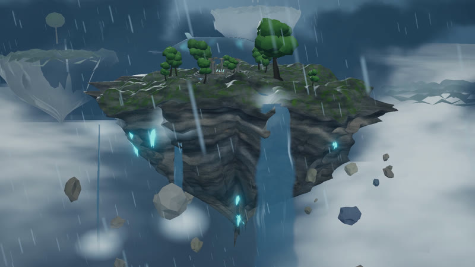
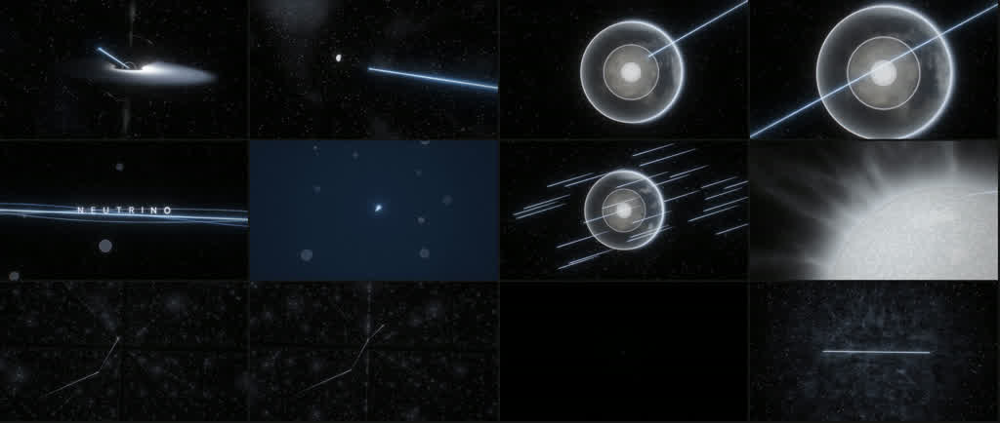

<div align="center">

# Claude Video

**A code-drawn film studio: two films, every frame made from code.**<br>
One floating island in a storm sky, one 2-minute neutrino science MV, both drawn entirely in code.<br>
<sub>两部用代码画出来的短片 · 🇨🇳 中文用户请看下方说明</sub>

<a href="claude-video/README.md"></a> <a href="https://github.com/haitaoworkspacebj/ff-claude-video"></a> <a href="#licence"></a>

⚠️ **Built for Claude.** The films are tuned for Claude Opus 5.5;<br>
other models may not reproduce them well, so use them with care.

<sub>Official repo: [github.com/haitaoworkspacebj/ff-claude-video](https://github.com/haitaoworkspacebj/ff-claude-video) · by [haitaoworkspacebj](https://github.com/haitaoworkspacebj)</sub>

</div>

## 🎬 Films

<table><tr>
<td width="50%" valign="top"><a href="claude-video/README.md"></a><br><b>▶ Skyward Realm</b> · 40 s · Three.js<br><sub>A camera pushes through a storm-lit cloud sea, orbits a floating island with waterfalls and ruins, then pulls back to reveal a whale and distant islands.</sub></td>
<td width="50%" valign="top"><a href="claude-video/video/neutrino/README.md"></a><br><b>▶ NEUTRINO</b> · 2:04 · Three.js + GLSL<br><sub>The story of how the IceCube Neutrino Observatory catches "ghost particles" in Antarctic ice — 7 acts, 33 lyric cues, beat-locked to 129.3 BPM.</sub></td>
</tr></table>

<div align="center">

Every frame, every note and every cut was written in code by Claude Opus 5.5.<br>
[**▶ Skyward Realm**](claude-video/README.md) · [**▶ NEUTRINO**](claude-video/video/neutrino/README.md)

</div>

## 👋 About

> **Not a stock-footage reel.** Every frame of both films was drawn by code, written with Claude Opus 5.5.

Every shot was directed, drawn, scored and mixed by an AI agent writing code:

- 🎨 **Picture**: Three.js + hand-written GLSL shaders, rendered frame by frame through a headless Chrome pipeline
- 🎵 **Music**: original scores from free sample libraries
- 🎙️ **Voice**: text-to-speech narration

No video generation, no stock footage.

## How to use

### Option 1: run the demos locally

```sh
git clone https://github.com/haitaoworkspacebj/ff-claude-video.git
cd ff-claude-video/claude-video

# Skyward Realm (interactive 3D)
npm install
npm run dev
# open http://localhost:5173 or http://localhost:5173/?cine=1

# NEUTRINO (beat-locked MV)
cd video/neutrino
node tools/serve.mjs
# open http://localhost:8080
```

### Option 2: read the source

Each film lives in its own folder with its own README:

- [`claude-video/README.md`](claude-video/README.md) — Skyward Realm timeline, camera choreography, and render pipeline
- [`claude-video/video/neutrino/README.md`](claude-video/video/neutrino/README.md) — NEUTRINO pipeline, beat-lock system, and 7-act storyboard

### Before you start

- Node 20+, ffmpeg 7+, and a Chrome/Chromium build for the headless render step.
- Skyward Realm: 1920×1080, 30 fps, 40 s. NEUTRINO: 1920×1080, 24 fps, 2:04.

## The projects

| Path | What it gives you |
|---|---|
| [`claude-video/src/cinema.ts`](claude-video/src/cinema.ts) | Skyward Realm camera choreography: 3 shots, keyframed azimuth / elevation / distance / fov |
| [`claude-video/src/world/`](claude-video/src/world/) | Skyward Realm scene elements: terrain, sky, clouds, water, trees, ruins, whale, rain, lightning |
| [`claude-video/video/render-frames.mjs`](claude-video/video/render-frames.mjs) | Skyward Realm headless-Chrome frame-by-frame renderer (CDP) |
| [`claude-video/video/neutrino/web/src/glsl/`](claude-video/video/neutrino/web/src/glsl/) | NEUTRINO GLSL shaders: volumetric ray-marching, accretion disk, Earth's interior, cosmic web |
| [`claude-video/video/neutrino/web/src/shots/`](claude-video/video/neutrino/web/src/shots/) | NEUTRINO shot timeline: 7 acts, 33 lyric cues, beat-locked cuts |
| [`claude-video/video/neutrino/mv/timeline.py`](claude-video/video/neutrino/mv/timeline.py) | NEUTRINO music analysis: BPM, beat phase, bass "breaths" |
| [`claude-video/video/neutrino/tools/export.mjs`](claude-video/video/neutrino/tools/export.mjs) | NEUTRINO deterministic export: headless Chrome → PNG frames → ffmpeg H.264 |

## Licence

- **Code and docs**: [MIT](LICENSE).
- **The films and their stills** (in `docs/` and `claude-video/video/`): [CC BY 4.0](https://creativecommons.org/licenses/by/4.0/). You may share, adapt and use them commercially; credit **haitaoworkspacebj** with a link to this repository, and say if you changed them.
